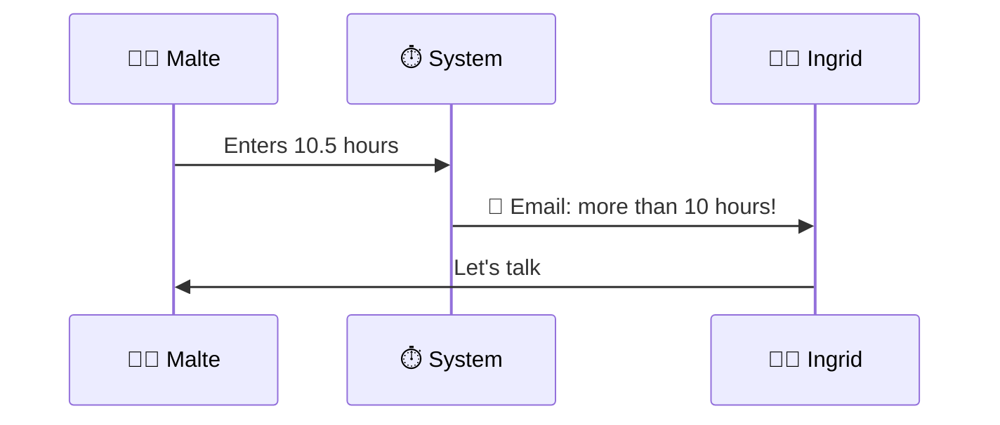

# 👥 Personas – STC Time Management System

> Based on the customer interview from **8 October 2026**.
> The personas are fictional, but their goals and problems come from the interview.

| | Persona | Role | In one sentence |
|:---:|---|---|---|
| 🧑‍🚒 | [Malte Jansen](#-persona-1-malte-jansen) | Employee | A consultant whose workday is often split by fire alarms. |
| 👩‍✈️ | [Ingrid Halvorsen](#-persona-2-ingrid-halvorsen) | Supervisor | A strict team leader who wants simple emails, not dashboards. |

---

## 🧑‍🚒 Persona 1: Malte Jansen

> 💬 *"Sometimes my workday has three parts."*

<table>
<tr><td><b>Age</b></td><td>34</td></tr>
<tr><td><b>Role</b></td><td>Employee</td></tr>
<tr><td><b>Job</b></td><td>IT security consultant at STC</td></tr>
<tr><td><b>Hobby</b></td><td>Volunteer firefighter in his village</td></tr>
<tr><td><b>Where he works</b></td><td>At customers, at home, sometimes in his camper van</td></tr>
<tr><td><b>Tech skills</b></td><td>⭐⭐⭐⭐⭐ Very good</td></tr>
</table>

### 🎯 Goals

- He wants to enter his working time **quickly on his phone**.
- He wants to enter **more than one work block per day**.
- He wants to see his **flex-time hours**.

### 😤 Problems

- The fire alarm can come at any time, so he must stop work.
- In the van, the internet is often bad.
- He gets **no warning** when he works more than 10 hours.

### 📅 Scenario: a typical day

```mermaid
gantt
    title Malte's workday
    dateFormat HH:mm
    axisFormat %H:%M
    section Day
    Work             :done,   07:00, 10:00
    Fire alarm 🚒    :crit,   10:00, 13:30
    Work             :done,   13:30, 19:00
```

Malte works from 7 to 10 o'clock. Then the fire alarm comes and he goes to help.
At 13:30 he starts work again and finishes at 19:00.
In the evening he enters two work blocks in the system.

> [!TIP]
> **Say it like this**
>
> *This is Malte. He is 34 years old and works as an IT security consultant. In his free time he is a volunteer firefighter. When the alarm comes, he must stop work. So his day often has two or three parts. For Malte, the system must be simple and work on his phone.*

---

## 👩‍✈️ Persona 2: Ingrid Halvorsen

> 💬 *"Nobody works more than 10 hours in my team."*

<table>
<tr><td><b>Age</b></td><td>58</td></tr>
<tr><td><b>Role</b></td><td>Supervisor</td></tr>
<tr><td><b>Job</b></td><td>Team leader of 9 consultants at STC</td></tr>
<tr><td><b>Before STC</b></td><td>Air traffic controller at Frankfurt Airport for 20 years</td></tr>
<tr><td><b>Where she works</b></td><td>In the STC office</td></tr>
<tr><td><b>Tech skills</b></td><td>⭐⭐ Not so good – she likes email, not dashboards</td></tr>
</table>

### 🎯 Goals

- She wants an **email** when someone works more than 10 hours.
- She wants to approve all timesheets **once a month**, quickly.
- She wants a **deputy** who approves timesheets when she is away.

### 😤 Problems

- Dashboards are too complicated for her.
- Employees sometimes cancel their vacation at the last minute.
- Next year she goes sailing for 3 months ⛵, and nobody can approve timesheets.

### 📅 Scenario

Ingrid gets an email: Malte worked 10.5 hours yesterday. She talks to Malte.
At the end of the month she approves all timesheets in 20 minutes.

> [!TIP]
> **Say it like this**
>
> *This is Ingrid. She is 58 years old and leads a team of nine people. Before STC, she was an air traffic controller, so rules are very important for her. She does not like dashboards. She wants a simple email when there is a problem. Next year she goes sailing for three months, so she needs a deputy in the system.*

---

